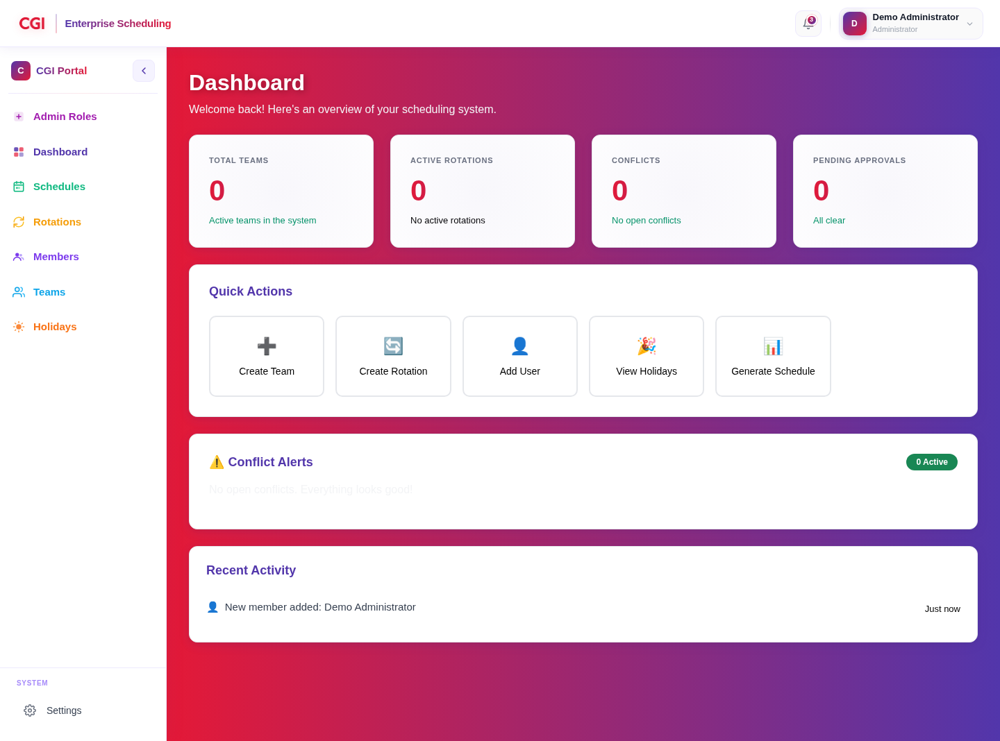
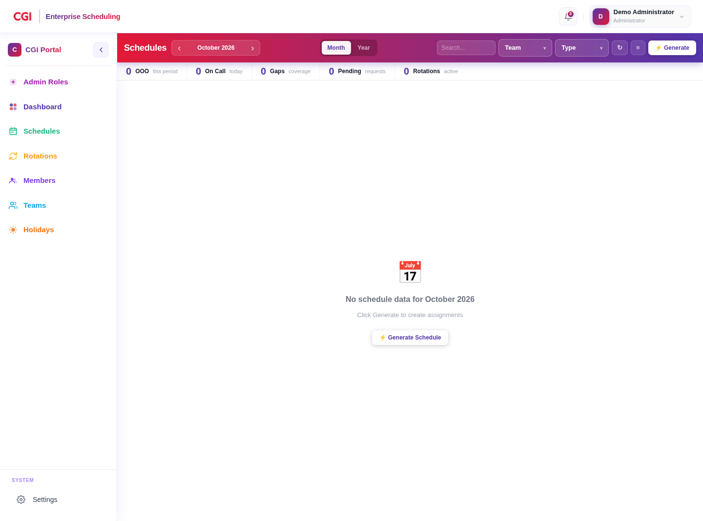
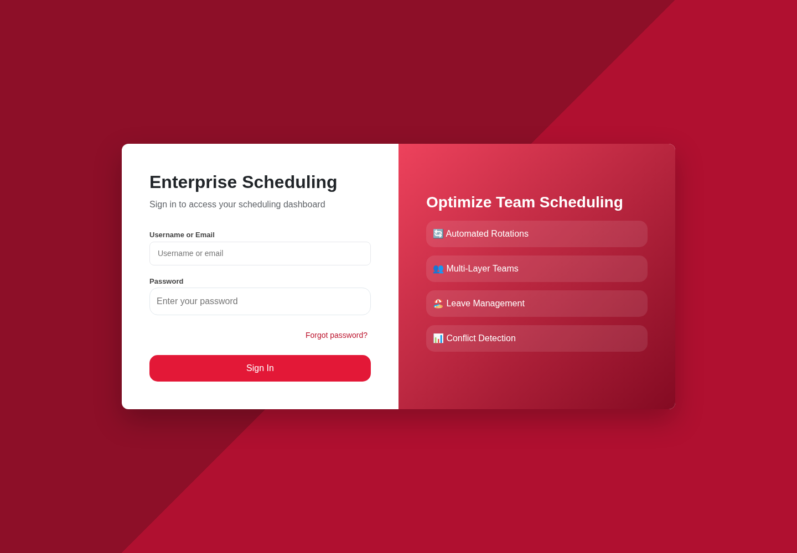
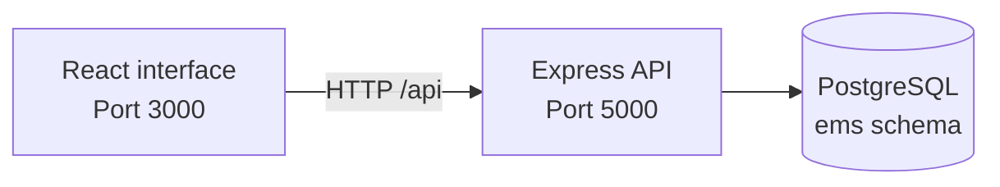

<div align="center">

# Enterprise Multi-Layer Scheduling System

**One workspace for teams, rotations, and organizational schedules.**

Coordinate responsibilities across groups and teams, manage rotation pools, and bring assignments, holidays, leave, and coverage into a shared view.

[Explore the app](#app-preview) · [Get started](#getting-started) · [Architecture](#architecture) · [Project guides](#documentation)


</div>

## Overview

Organizations often need several schedules at once: team duties, on-call coverage, specialized responsibilities, and rotations shared across teams. This application organizes those responsibilities around a common organizational model and provides tools to configure rotations and generate assignments.

The project includes a React interface, an Express API, and a PostgreSQL schema. It is a development-stage application; the features below describe the current interface and implementation, rather than a guarantee of production readiness.

## App preview

These screenshots show the actual application running locally. The dashboard and schedule use a temporary demonstration session with an otherwise empty development database; no production information is shown.

### Dashboard

An overview of team and rotation counts, conflicts, pending approvals, quick actions, and recent activity.



### Schedule workspace

Month and year views, team and rotation-type filters, coverage summaries, and schedule-generation controls.



<details>
<summary><strong>View the sign-in screen</strong></summary>



</details>

## Features

| Area | What the application provides |
| --- | --- |
| Organizational structure | Groups, teams, team membership, and member profiles |
| Rotation management | Rotation pools, cadence settings, templates, and drag-and-drop member ordering |
| Schedule generation | Assignments generated from a rotation and date window, including cross-team member expansion |
| Availability | Holiday and approved-leave checks during generation, with coverage-gap handling |
| Schedule review | Calendar views, filtering, assignment overrides, and conflict information |
| Dashboard | Role-specific views and summaries for teams, rotations, approvals, conflicts, and recent activity |
| Account management | Account roles, password changes, token refresh, failed-login tracking, and lockout handling |
| Location data | Country, province, and city records used by member and holiday workflows |

The interface recognizes **Administrator**, **Team Leader**, **Rotation Owner**, and **Individual** roles. Server-side role checks protect schedule generation; authorization coverage should be reviewed before exposing the API outside a trusted development environment.

## Architecture



- **Frontend:** React 19, React Router, Axios, Bootstrap, and dnd-kit; built with Create React App.
- **Backend:** Node.js, Express 5, node-postgres, JWT authentication, and Argon2/bcrypt password libraries.
- **Database:** PostgreSQL with the `ems` schema and `pgcrypto` extension.

```text
.
├── backend/
│   ├── server.js                # API entry point
│   └── src/
│       ├── auth/                # Login, password, and token workflows
│       ├── config/              # Database connection and schema.sql
│       ├── middleware/          # Authorization, logging, error handling
│       └── modules/             # Teams, members, rotations, schedules, etc.
├── frontend/
│   ├── public/
│   └── src/
│       ├── api/                 # Axios client
│       ├── components/          # Shared UI and application layout
│       ├── pages/               # Application screens
│       ├── routes/              # Navigation and route guards
│       └── styles/
├── Documents/                   # Installation and user guides
├── docs/screenshots/            # README screenshots
└── docker-compose.yml
```

## Getting started

### Prerequisites

- **Node.js 22.13.1 or later** and **npm 10 or later**.
- **PostgreSQL 18.2 or later**, matching the installation guide and schema export.
- Git and a PostgreSQL client such as `psql` or pgAdmin.
- Native build tools if your platform cannot use the prebuilt Argon2/bcrypt binaries.

The cloud development setup was checked with Node.js 24.19.0, npm 11.9.0, and PostgreSQL 18.

### 1. Clone and install

```bash
git clone https://github.com/12Walid-cmd/Enterprise-Multi-Layer-Scheduling-System.git
cd Enterprise-Multi-Layer-Scheduling-System

(cd backend && npm ci)
(cd frontend && npm ci)
```

Each component has its own manifest and lockfile. Run dependency commands inside the corresponding directory. The repository currently tracks some backend dependency files, so reinstalling them may appear in your Git diff; keep dependency artifacts out of unrelated contributions.

### 2. Configure the backend

```bash
cp backend/.env.example backend/.env
```

On Windows Command Prompt, use `copy backend\.env.example backend\.env`.

Set your local database connection in `backend/.env`:

```dotenv
DB_HOST=localhost
DB_PORT=5432
DB_NAME=enterprise_scheduling_system
DB_USER=postgres
DB_PASSWORD=<your-local-database-password>
PORT=5000
JWT_SECRET=<a-long-random-secret>
ACCESS_TOKEN_TTL=10m
REFRESH_TOKEN_TTL_DAYS=7
MAX_LOGIN_ATTEMPTS=5
LOCKOUT_MINUTES=15
```

Replace both placeholders before starting. Keep `.env` private. The backend falls back to a development JWT secret when `JWT_SECRET` is unset; configure your own secret for any shared environment.

| Variable | Purpose |
| --- | --- |
| `DB_HOST`, `DB_PORT` | PostgreSQL server address |
| `DB_NAME`, `DB_USER`, `DB_PASSWORD` | Database and connection credentials |
| `PORT` | API listening port; the frontend currently expects `5000` |
| `JWT_SECRET` | JWT signing and verification secret |
| `ACCESS_TOKEN_TTL` | Access-token lifetime, for example `10m` |
| `REFRESH_TOKEN_TTL_DAYS` | Refresh-token lifetime in days |
| `MAX_LOGIN_ATTEMPTS` | Failed attempts before lockout |
| `LOCKOUT_MINUTES` | Lockout duration |
| `SUPER_ADMIN_EMAIL` | Optional protected administrator identity; defaults to `admin@example.com` |

### 3. Create and initialize the database

With PostgreSQL running, execute:

```bash
createdb -h localhost -U postgres enterprise_scheduling_system
psql -h localhost -U postgres -d enterprise_scheduling_system \
  -v ON_ERROR_STOP=1 --single-transaction -f backend/src/config/schema.sql
psql -h localhost -U postgres -d enterprise_scheduling_system \
  -c 'ALTER DATABASE enterprise_scheduling_system SET search_path TO ems, public;'
```

The search path is needed because some backend queries use unqualified table names. Reconnect any existing database clients after changing it. In pgAdmin, create the database, open `schema.sql` in Query Tool, execute it, and run the same `ALTER DATABASE` statement.

Import the schema into a **new database**. It creates tables and constraints but supplies no users, roles, teams, or example schedules; it is not an incremental migration script.

### 4. Start both components

In the first terminal:

```bash
cd backend
npm run dev
```

In the second terminal:

```bash
cd frontend
npm start
```

Open the frontend at `http://localhost:3000`. The backend runs at `http://localhost:5000`, with application endpoints under `/api`.

The frontend currently hardcodes `http://localhost:5000` in its API client. These instructions assume a local browser and the default backend port; hosting the frontend remotely requires adapting that configuration.

### 5. Provision the first account

There is no bundled demo login or public registration workflow. Provision a development user, its `ems.team_members` record, and the appropriate `ems.account_roles` entries before signing in. The [installation guide](Documents/CodeSaurus_Installation_Guide.docx) explains the role-assignment relationship.

To assign an existing Administrator role to an existing member, run this query with the intended user's email:

```sql
INSERT INTO ems.user_account_roles (user_id, role_id)
SELECT tm.id, ar.id
FROM ems.users u
JOIN ems.team_members tm ON tm.user_id = u.id
CROSS JOIN ems.account_roles ar
WHERE LOWER(u.email) = LOWER('your-development-user@example.com')
  AND LOWER(ar.name) = 'administrator'
ON CONFLICT DO NOTHING;
```

`user_account_roles.user_id` references **`team_members.id`**, rather than `users.id`. The query assigns a role only when the user, membership, and role already exist; check that rows were inserted. The sign-in workflow supports temporary passwords and prompts for a password change when required.

## Docker alternative

The repository includes Dockerfiles and a Compose configuration. Review it before use: its database image is PostgreSQL **16**, while the installation guide and schema export target **18**. The native setup above is the validated path.

For a compatible local Docker setup, align the database image with PostgreSQL 18 in a local override, create `backend/.env`, and ensure its database credentials match the Compose database service. The checked-in Compose service uses `postgres` for both username and password and overrides `DB_HOST` to `db` for the backend.

```bash
docker compose up --build
```

Schema initialization runs only when the database volume is first created. Configure the database search path as described above, and provision the first account. `docker compose down` stops the stack; **`docker compose down -v` deletes its database volume**.

## Useful commands and validation

| Directory | Command | Purpose |
| --- | --- | --- |
| `backend` | `npm run dev` | API with automatic restart |
| `backend` | `npm start` | API without a development watcher |
| `frontend` | `npm start` | Development server with hot reload |
| `frontend` | `npm run build` | Production frontend bundle |
| `frontend` | `npm test` | Create React App test runner; no application tests are currently supplied |

To check a running development instance:

```bash
curl http://localhost:5000/
curl http://localhost:5000/api/groups
```

The root endpoint returns `{"message":"EMS Backend Running"}`. The groups endpoint returns a JSON array, including `[]` for an empty database.

Cloud setup validation covered schema import, database-backed API reads, a temporary group create/read operation, native password hashing, frontend compilation, and the production build. The frontend build reports existing ESLint warnings. These checks do not constitute a full end-to-end test suite.

## Troubleshooting

| Symptom | Check |
| --- | --- |
| Database connection refused | PostgreSQL is running; `.env` host, port, and credentials match it |
| `relation ... does not exist` | Schema import completed and the database search path includes `ems` |
| Login says user not found | A user and membership have been provisioned; the schema contains no seed accounts |
| Schedule generation returns `403` | The authenticated user has an Administrator role through the membership record |
| Frontend cannot reach the API | API is running on port `5000`; browser can reach its hardcoded localhost address |
| Native dependency installation fails | Supported Node version and platform build prerequisites are installed |
| Address already in use | Another process occupies port `3000`, `5000`, or `5432` |

## Documentation

- [Installation guide](Documents/CodeSaurus_Installation_Guide.docx): prerequisites, configuration, database setup, and administration.
- [User guide](Documents/CodeSaurus_User_Guide.docx): application workflows.
- [Database schema](backend/src/config/schema.sql): tables, relationships, and constraints.

## Contributing

Keep changes focused, describe the behavior affected, and include relevant verification in your pull request. Do not commit credentials, local environment files, generated builds, or dependency artifacts. For interface changes, include screenshots that use demonstration data.

## Project scope and licensing

Payroll and time tracking are outside the project's scope. Before production deployment, review API authorization, authentication flows, secret management, CORS, backups, and deployment configuration.

No repository-level license file is currently included. The backend package metadata declares ISC; that alone does not establish licensing terms for the entire project.
